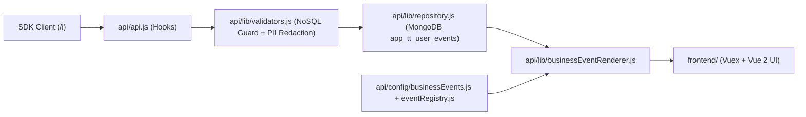

# Guida di Onboarding — TT User Insights (`tt-user-insights`)

Benvenuto sul progetto **TT User Insights**, il modulo proprietario della suite **TT Analytics** sviluppato da **TT Studio** per **Countly Server (`v25.03.0`)**.

Questa guida è pensata per portarti a regime in **meno di 60 minuti**, evitando di perderti nell'intero monorepo di Countly Core (`37` plugin nativi) e concentrandoti solo su ciò che ti serve in base al tuo ruolo.

---

## Indice Rapido per Ruolo

- **Sviluppatore App Client (Web / iOS / Android / Backend integrato con SDK Countly):**
  Ti bastano il **[Passo 1](#passo-1--visione-dinsieme-e-contratto-di-tracking-15-min)** e la **[Checklist Integrazione SDK](#checklist-rapida--integrazione-nuova-app-client)**.
- **Sviluppatore Full-Stack / Backend sul Plugin Countly (`tt-user-insights`):**
  Segui tutti i **4 Passi** in ordine e usa i **[Task Pratici di Esempio](#task-pratici-comuni-ricette-rapide)**.

---

## Principio Architetturale Chiave: *Zero Core Modification*

Questo repository contiene l'intero codice di **Countly Server v25.03.0**, ma il nostro lavoro risiede **esclusivamente** dentro:

```text
plugins/tt-user-insights/
```

**Regola d'oro:** Non modificare mai i file del core di Countly (`api/`, `frontend/express/`, o gli altri plugin nativi in `plugins/`). Tutto deve passare tramite gli hook, i punti di estensione e le collezioni dedicate del plugin `tt-user-insights`, così da garantire aggiornamenti futuri di Countly privi di conflitti.

---

## Passo 1 — Visione d'Insieme e Contratto di Tracking (15 min)

Inizia leggendo questi due documenti nella cartella del plugin:

1. **[`README.md`](./README.md)** — Panoramica funzionale e architetturale:
   - Cosa fa la vista **`#/analytics/user-insights`** (Ricerca utente, User Overview, User Activity Timeline, Live Events Stream, Error Breadcrumbs).
   - Come sono separate le collezioni MongoDB:
     - `app_users{app_id}`: collezione nativa di Countly (letta dal plugin e arricchita con `user_details`).
     - `app_tt_user_events{app_id}`: collezione dedicata creata dal plugin con **7 indici** e **TTL automatico** (default `180` giorni).
2. **[`TT_TRACKING_STANDARD.md`](./TT_TRACKING_STANDARD.md)** — Il contratto dati ufficiale (**TT Analytics Tracking Standard v1**):
   - Come associare l'utente autenticato al login (`change_id` + `user_details` + evento `user_login`).
   - Come funzionano le **Sessioni** (`begin_session`, `session_duration`, `end_session`) e perché il plugin raggruppa gli eventi per sessione **solo** quando esiste un `sid` reale.
   - Come funziona il tracciamento delle schermate **`[CLY]_view` a 2 fasi** (apertura con `visit: 1` e chiusura con `dur`), e la regola fondamentale: **se l'SDK non invia la durata `dur`, il plugin non la simula mai per differenza di timestamp**.
   - Il catalogo delle **9 categorie** di eventi standard (`authentication`, `navigation`, `search`, `catalog`, `cart`, `order`, `document`, `engagement`, `error`).

---

## Passo 2 — Convenzioni e Sicurezza di Countly Server (10 min)

Prima di scrivere codice sul plugin, leggi nella root del repository:

3. **[`../../CLAUDE.md`](../../CLAUDE.md)** (e opzionalmente [`../AGENT.md`](../AGENT.md)):
   - Sintetizza come Countly registra route API (`plugins.register("/o/...", ...)`), lifecycle hooks (`/i/apps/create`, `/i/apps/delete`, `/i/app_users/delete`) e componenti frontend Vue 2 (`countlyVue.views.create`).
   - **Regole di sicurezza non negoziabili:**
     1. Ogni endpoint `/o/tt-user-insights/*` deve verificare i permessi con `validateRead(params, "tt_user_insights", ...)`.
     2. Ogni query/scrittura deve essere strettamente isolata per `app_id` (validato come ObjectId esadecimale a 24 caratteri).
     3. Tutti i parametri di input devono essere validati contro **NoSQL Injection** (rifiutando oggetti, chiavi con `$` o `.`).
     4. Mai usare `v-html` con dati provenienti dagli eventi o dagli utenti nei template Vue.
     5. La **PII Redaction** oscura automaticamente password, token, JWT, Bearer e numeri di carta di credito (algoritmo di Luhn) sia in ingresso che in uscita.

---

## Passo 3 — Giro Guidato nel Codice del Plugin (20 min)

Apri i file di `plugins/tt-user-insights/` in questo ordine logico (dal dato grezzo in ingresso fino alla UI):



### 1. Configurazione e Catalogo Eventi
- **[`config.js`](./config.js)**: impostazioni di retention (`retention_days: 180`), flag di cattura (`capture_views`, `capture_sessions`, `capture_custom_events`) ed elenco delle chiavi sensibili soggette a redazione (`[REDACTED]`).
- **[`api/config/businessEvents.js`](./api/config/businessEvents.js)**: definizioni dichiarative di tutte le categorie e degli eventi dello standard TT Analytics v1 (icone, chiavi di traduzione, campi primari e di dettaglio, formattatori valuta/durata/badge).
- **[`api/lib/eventRegistry.js`](./api/lib/eventRegistry.js)**: registry in-memory estendibile a runtime che gestisce categorie, definizioni eventi e custom renderer.

### 2. Sicurezza, Validazione e Trasformazione Business
- **[`api/lib/validators.js`](./api/lib/validators.js)**: validazione rigorosa di `app_id`, filtri, paginazione (`MAX_PAGE_LIMIT = 100`), guardia NoSQL injection e motore di **PII Redaction** (`sanitizeEventSegments`).
- **[`api/lib/businessEventRenderer.js`](./api/lib/businessEventRenderer.js)**: trasforma un record grezzo di MongoDB in un oggetto strutturato per l'operatore (titolo localizzabile, descrizione, metadati formattati, estrazione **Search Analytics** per `search_performed`, più payload `rawData` separato per il drawer tecnico).

### 3. Persistenza MongoDB ed Endpoint API
- **[`api/lib/repository.js`](./api/lib/repository.js)**:
  - Creazione dei 7 indici MongoDB (`ensureIndexesForApp`).
  - Ingestione eventi, sessioni e aggiornamento a 2 fasi della durata sulle schermate (`[CLY]_view`).
  - Ricerca utenti (`searchUsers`), profilo (`getUserOverview`), timeline con raggruppamento sessioni (`getUserTimeline`), **Live Events Stream** (`getLiveEventsStream`) ed **Error Breadcrumbs** (`getEventBreadcrumbs`).
- **[`api/api.js`](./api/api.js)**:
  - Registra la feature di permesso `tt_user_insights`.
  - Si aggancia agli hook interni di Countly (`/i/events`, `/i/sessions`, `/sdk/user_properties`, `/i/apps/create`, `/i/apps/delete`, `/i/app_users/delete`, `/i/apps/clear`, `/i/apps/reset`).
  - Espone i **6 endpoint REST**:
    - `GET /o/tt-user-insights/users`
    - `GET /o/tt-user-insights/details`
    - `GET /o/tt-user-insights/timeline`
    - `GET /o/tt-user-insights/live`
    - `GET /o/tt-user-insights/breadcrumbs`
    - `GET /o/tt-user-insights/definitions`

### 4. Frontend (Vue 2 + Vuex + Localizzazione)
- **[`frontend/public/javascripts/countly.models.js`](./frontend/public/javascripts/countly.models.js)**: store Vuex (`clyTTUserInsights`), stato reattivo per Timeline e Live Stream, chiamate API e helper di formattazione.
- **[`frontend/public/javascripts/countly.views.js`](./frontend/public/javascripts/countly.views.js)**: componente Vue 2 principale, gestione filtri, polling Live Stream, caricamento Breadcrumbs nel drawer e registrazione nella sidebar Analytics (`#/analytics/user-insights`).
- **[`frontend/public/templates/main.html`](./frontend/public/templates/main.html)**: template HTML del componente (barra ricerca utenti, User Overview card, tab Timeline / Live Stream, filtri rapidi, gruppi di sessione, ed Event Details Drawer con tab *Business* / *Breadcrumbs* / *Raw JSON*).
- **[`frontend/public/stylesheets/main.scss`](./frontend/public/stylesheets/main.scss)**: stili SCSS con convenzione BEM `.cly-vue-tt-insights`.
- **[`frontend/public/localization/`](./frontend/public/localization/)**: file `.properties` in Inglese (default) e Italiano (`_it`).

---

## Passo 4 — Eseguire i Test e Verificare l'Ambiente (10 min)

Il plugin include una suite di **24 test unitari e architetturali** in [`test/unit.test.js`](./test/unit.test.js) che non richiede né MongoDB né Countly in esecuzione (utilizza un mock MongoDB in-memory fedele al comportamento reale).

Esegui subito da terminale nella root del repository:

```bash
node --test plugins/tt-user-insights/test/unit.test.js
```

Tutti i **24 test** devono passare in meno di mezzo secondo. Leggere `test/unit.test.js` è anche il modo migliore per vedere esempi concreti di payload in ingresso e output attesi.

### Comandi Utili su Countly Server (Ambiente Dev / Staging)

```bash
# 1. Abilitare il plugin sull'istanza Countly
countly plugin enable tt-user-insights
countly upgrade

# 2. Compilare i file SCSS in CSS (dopo modifiche a main.scss)
npx grunt sass

# 3. Compilare localizzazioni e bundle statici (dopo modifiche JS/properties)
npx grunt locales
npx grunt dist-all

# 4. Eseguire i test di integrazione Countly (richiede istanza Countly + MongoDB attivi)
npm run test:plugin -- tt-user-insights
```

> ⚠️ **Nota importante su `.gitignore` e `main.css`:**
> Il file [`.gitignore`](../../.gitignore) principale di Countly ignora tutti i CSS compilati dei plugin (`plugins/*/frontend/public/stylesheets/*.css`) e `plugins/plugins.json`.
> - Modifica **sempre e solo** `main.scss`, mai `main.css` direttamente.
> - Quando fai deploy o aggiorni un ambiente, `countly upgrade` (o `npx grunt sass`) rigenera automaticamente `main.css`.

---

## Task Pratici Comuni (Ricette Rapide)

### Come aggiungere un nuovo Business Event allo standard
Se un'app TT Studio introduce un nuovo evento business (es. `invoice_downloaded`):

1. **Dichiarazione evento:** aggiungi la definizione in [`api/config/businessEvents.js`](./api/config/businessEvents.js) specificando `key`, `category`, `icon`, `titleKey`, `descriptionKey` e l'array `fields`.
2. **Traduzioni UI:** aggiungi le chiavi corrispondenti in:
   - [`frontend/public/localization/tt-user-insights.properties`](./frontend/public/localization/tt-user-insights.properties)
   - [`frontend/public/localization/tt-user-insights_it.properties`](./frontend/public/localization/tt-user-insights_it.properties)
3. **Documentazione SDK:** documenta il nuovo evento e le sue proprietà in [`TT_TRACKING_STANDARD.md`](./TT_TRACKING_STANDARD.md).
4. **Test:** aggiungi un caso di test in [`test/unit.test.js`](./test/unit.test.js) ed esegui `node --test plugins/tt-user-insights/test/unit.test.js`.

---

## Checklist Rapida — Integrazione Nuova App Client

Se devi integrare il tracking su una nuova applicazione Web o Mobile verso Countly:

- [ ] L'SDK Countly avvia il tracciamento sessioni (`track_sessions` / `beginSession`).
- [ ] Al login viene chiamato `change_id` con l'ID univoco dell'utente applicativo.
- [ ] Al login vengono inviati i metadati anagrafici tramite `user_details` (`name`, `username`, `email`, `organization`, `custom`).
- [ ] Al login/logout vengono inviati gli eventi `user_login` / `user_logout`.
- [ ] Le cambi schermata usano il tracciamento view nativo (`track_pageview` / `recordView`) così da inviare sia l'apertura (`visit: 1`) sia la durata di chiusura (`dur`).
- [ ] Le ricerche utente inviano `search_performed` con `query`, `results_count`, `category`, `filters`.
- [ ] Nessuna password, token o dato di pagamento viene mai inserito dentro `segmentation` (il plugin applica comunque la PII Redaction, ma i client non devono inviarli).

